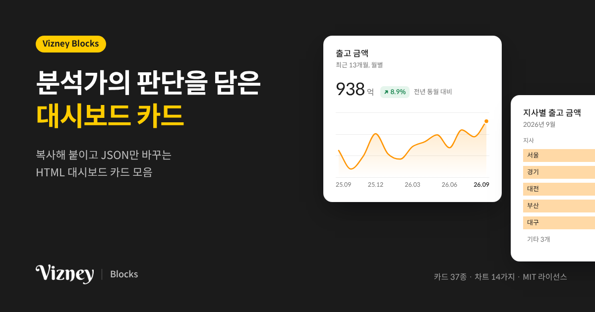

# Vizney Blocks

복사해 붙여 쓰는 HTML 대시보드 카드 모음입니다. KPI, 막대, 라인, 그리드, 도넛, 스캐터, 트리맵, 히트맵, 워터폴, 퍼널, 와플, 범프, 생키, 레이더 차트 37종을 [Vizney 차트 가이드](https://kr.vizney.com/chart-guide/)의 판단 규칙으로 만들었습니다.

Copy-paste HTML dashboard cards (37 cards in 14 chart types). No install, no framework: each card is one self-contained HTML snippet. The gallery, the card pages and llms.txt are in Korean and English; the skill and this README are in Korean.

**갤러리(English): https://blocks.vizney.com** · **한국어: https://blocks.vizney.com/ko/**



## 쓰는 법

1. 차트 페이지에서 카드를 골라 **복사 → 카드 코드 복사**를 누르고, HTML의 `<body>` 안 원하는 자리에 붙여 넣습니다. **코드**를 누르면 바꿀 데이터(JSON) 줄을 표시한 전체 코드를 볼 수 있습니다.
2. 카드 안 `<script type="application/json">`의 값만 바꿉니다. 증감, 비중, 달성률, 합계는 카드가 계산합니다. 영어 화면에 쓸 때는 `"lang": "en"`을 더하면 합계 · 기타 · 달성처럼 카드가 직접 적는 문구가 영어가 됩니다.
3. 색과 글꼴은 내 페이지 `:root`의 `--vzb-*` 변수로 바꿉니다. 변수 목록과 쓰임은 [tokens.css](https://blocks.vizney.com/tokens.css)에 있습니다.

카드 하나는 스타일, 데이터, 스크립트를 한데 묶은 HTML 조각이라 설치할 라이브러리가 없습니다. 카드는 놓인 자리의 폭을 채우고, 높이는 1 · 1.5 · 2단위(1단위 168px) 중 하나입니다. 같은 줄의 카드는 가장 높은 카드에 맞춰 늘어나므로 높이가 같은 카드끼리 한 줄에 두면 빈 곳이 없습니다. 여러 장은 감싸는 요소에 격자를 주고, 카드 폭이 340px보다 좁아지지 않게 합니다. 더 좁으면 표와 도넛의 글자가 잘립니다(KPI 카드만 둔 줄은 280px까지 괜찮아, 폭 1280px 화면에 네 장이 한 줄에 들어갑니다).

```html
<div style="display:grid; grid-template-columns:repeat(auto-fit, minmax(min(100%, 340px), 1fr)); gap:16px;">
  <!-- 카드 여러 장 -->
</div>
```

## 목적으로 고르기

카드는 차트 모양보다 화면이 답할 질문에서 고르는 편이 빠릅니다. 현황, 추이, 목표, 비교, 구성, 표, 증감, 흐름, 관계의 아홉 가지 목적마다 기본 카드 하나와, 조건이 맞을 때만 쓰는 카드를 정리했습니다. 색인은 [갤러리 첫 화면](https://blocks.vizney.com/ko/#purpose)과 [llms.txt](https://blocks.vizney.com/llms.txt)에 있습니다.

## AI에게 맡기기

카드의 **복사 → AI용 링크 복사**는 카드 코드 주소(`https://blocks.vizney.com/cards/<카드 id>.txt`)를 복사합니다. 이 주소를 AI에게 주고 “이 카드로 우리 매출 데이터를 그려줘”처럼 요청하면 됩니다. 전체 카드 목록과 목적 색인, 카드마다의 규칙은 [llms.txt](https://blocks.vizney.com/llms.txt)에 있습니다.

Claude Code, Cursor, Codex 같은 코딩 에이전트에는 스킬로 설치할 수 있습니다. 스킬에는 목적 색인과 쓰는 규칙이 들어 있어, 에이전트가 화면의 질문마다 카드를 고르고 JSON만 바꿔 대시보드를 만듭니다.

```bash
npx skills add yehwanhwang/vizney-blocks
```

[OpenDesign](https://open-design.ai)에서는 같은 폴더를 플러그인으로 설치합니다. 앱의 **Plugins → Add → Skill → Import from link**에 `https://github.com/yehwanhwang/vizney-blocks/tree/main/skills/vizney-blocks`를 넣거나, 터미널에서 `od plugin install github:yehwanhwang/vizney-blocks/skills/vizney-blocks`를 실행합니다.

## 영문 페이지와 한국어 페이지

v0.30부터 영문 페이지가 메인입니다. 첫 화면과 차트 페이지는 영어가 `/`(`/bar/` 등), 한국어가 `/ko/`(`/ko/bar/` 등)에 있고, 머리의 EN · KO로 같은 페이지를 오갑니다. 예전 영문 주소(`/en/`, `/en/bar/`)는 같은 페이지의 `/`로 넘어갑니다.

AI와 다른 페이지가 쓰는 주소는 그대로입니다. 한국어 카드 코드와 목록은 `/cards/<id>.html`, `.txt`, [llms.txt](https://blocks.vizney.com/llms.txt), [tokens.css](https://blocks.vizney.com/tokens.css)에, 영어는 `/en/cards/<id>.html`, `.txt`, [llms.txt](https://blocks.vizney.com/en/llms.txt), [tokens.css](https://blocks.vizney.com/en/tokens.css)에 있습니다. 카드 코드는 한 벌이고, 영문 카드는 영어 예시 데이터에 `"lang": "en"`을 넣은 것입니다. 차트 가이드 링크는 영어는 www.vizney.com, 한국어는 kr.vizney.com으로 갑니다. 목록에서 내린 카드의 주소는 한국어에만 있습니다.

## 카드 목록

- **[KPI 카드](https://blocks.vizney.com/ko/kpi/)**: [KPI - Number](https://blocks.vizney.com/cards/kpi-number.html), [KPI - Line](https://blocks.vizney.com/cards/kpi-line.html), [KPI - Bar](https://blocks.vizney.com/cards/kpi-bar.html), [KPI - Gauge](https://blocks.vizney.com/cards/kpi-gauge.html), [KPI - Stacked Bar](https://blocks.vizney.com/cards/kpi-stacked-bar.html)
- **[막대 차트](https://blocks.vizney.com/ko/bar/)**: [Bar - Basic](https://blocks.vizney.com/cards/bar-basic.html), [Bar - Stacked](https://blocks.vizney.com/cards/bar-stacked.html), [Bar - Stacked 100%](https://blocks.vizney.com/cards/bar-stacked-100.html), [Bar - Target](https://blocks.vizney.com/cards/bar-target.html), [Bar - Diverging](https://blocks.vizney.com/cards/bar-diverging.html), [Bar - Ranking](https://blocks.vizney.com/cards/bar-ranking.html), [Bar - Compare](https://blocks.vizney.com/cards/bar-compare.html), [Bar - Butterfly](https://blocks.vizney.com/cards/bar-butterfly.html)
- **[라인 차트](https://blocks.vizney.com/ko/line/)**: [Line - Basic](https://blocks.vizney.com/cards/line-basic.html), [Line - Tabs](https://blocks.vizney.com/cards/line-tabs.html), [Line - Multiple](https://blocks.vizney.com/cards/line-multiple.html), [Line - Compare](https://blocks.vizney.com/cards/line-compare.html), [Line - Cumulative](https://blocks.vizney.com/cards/line-cumulative.html), [Line - Reference](https://blocks.vizney.com/cards/line-reference.html)
- **[그리드 차트](https://blocks.vizney.com/ko/grid/)**: [Grid - Basic](https://blocks.vizney.com/cards/grid-basic.html), [Grid - Spark](https://blocks.vizney.com/cards/grid-spark.html), [Grid - Target](https://blocks.vizney.com/cards/grid-target.html), [Grid - Pivot](https://blocks.vizney.com/cards/grid-pivot.html)
- **[도넛 차트](https://blocks.vizney.com/ko/donut/)**: [Donut - Basic](https://blocks.vizney.com/cards/donut-basic.html)
- **[스캐터 차트](https://blocks.vizney.com/ko/scatter/)**: [Scatter - Basic](https://blocks.vizney.com/cards/scatter-basic.html), [Scatter - Quadrant](https://blocks.vizney.com/cards/scatter-quadrant.html), [Scatter - Connected](https://blocks.vizney.com/cards/scatter-connected.html)
- **[트리맵 차트](https://blocks.vizney.com/ko/treemap/)**: [Treemap - Basic](https://blocks.vizney.com/cards/treemap-basic.html)
- **[히트맵 차트](https://blocks.vizney.com/ko/heatmap/)**: [Heatmap - Basic](https://blocks.vizney.com/cards/heatmap-basic.html)
- **[워터폴 차트](https://blocks.vizney.com/ko/waterfall/)**: [Waterfall - Basic](https://blocks.vizney.com/cards/waterfall-basic.html), [Waterfall - Subtotal](https://blocks.vizney.com/cards/waterfall-subtotal.html)
- **[퍼널 차트](https://blocks.vizney.com/ko/funnel/)**: [Funnel - Flow](https://blocks.vizney.com/cards/funnel-flow.html)
- **[와플 차트](https://blocks.vizney.com/ko/waffle/)**: [Waffle - Basic](https://blocks.vizney.com/cards/waffle-basic.html)
- **[범프 차트](https://blocks.vizney.com/ko/bump/)**: [Bump - Basic](https://blocks.vizney.com/cards/bump-basic.html)
- **[생키 차트](https://blocks.vizney.com/ko/sankey/)**: [Sankey - Basic](https://blocks.vizney.com/cards/sankey-basic.html), [Sankey - Levels](https://blocks.vizney.com/cards/sankey-levels.html)
- **[레이더 차트](https://blocks.vizney.com/ko/radar/)**: [Radar - Basic](https://blocks.vizney.com/cards/radar-basic.html)

### 목록에서 내린 카드

v0.23에서 같은 질문에 답하는 카드가 이미 있는 11장을 갤러리, llms.txt, 스킬에서 내렸습니다. 쓰고 있는 링크가 깨지지 않도록 카드 주소(`/cards/<id>.html`, `.txt`)와 코드는 그대로 두었고, 코드 맨 위 주석과 카드 페이지에 대신 쓸 카드를 적었습니다.

| 내린 카드 | 대신 쓸 카드 |
|---|---|
| KPI - Paired Bar | KPI - Number |
| Bar - Tabs | Line - Tabs |
| Bar - Grouped | Bar - Compare |
| Bar - Progress | Grid - Target |
| Line - Slope | Bar - Stacked 100% |
| Grid - Bars | Bar - Compare |
| Donut - Tabs | Donut - Basic |
| Funnel - Layers | Funnel - Flow |
| Funnel - Area | Funnel - Flow |
| Bump - Focus | Bump - Basic |
| Radar - Compare | Radar - Basic |

## 소스에서 빌드하기

Node.js 18 이상과 Python 3의 fontTools가 필요합니다. 사이트와 갤러리 페이지에 넣을 부분 글꼴을 만들 때 [Spoqa Han Sans Neo](https://github.com/spoqa/spoqa-han-sans) 저장소의 `Original/SpoqaHanSansNeo` 폴더(`SpoqaHanSansNeo-Regular.ttf`, `-Medium.ttf`, `-Bold.ttf`)를 씁니다. `Subset` 폴더의 글꼴은 커닝과 일부 기호(© – −)가 빠져 있고 Windows에서 줄 안의 글자 위치가 달라지므로 쓰지 않습니다.

```bash
pip install fonttools
SPOQA_DIR=/path/to/spoqa-han-sans/Original/SpoqaHanSansNeo node build.mjs
```

빌드는 맨 앞에서 `guard.mjs`를 돌려 카드가 규칙을 지키는지 검사합니다(외부 리소스 없음, 색은 `tokens.css`의 변수만, 높이 1·1.5·2단위, 선택자와 변수는 `vzb` 접두, 애니메이션에 reduced-motion 규칙, 툴팁은 키보드로도, 예시 JSON의 길이와 계산 필드, meta.json과 파일의 짝, 공개된 카드 주소 유지, 카드 안 문구는 모두 `tx()`를 거쳐 영어가 있을 것, 영어 예시 데이터와 영어 문구가 카드마다 있을 것). 어긋나면 사유를 적고 멈춥니다. 글꼴 없이 검사만 하려면 `node build.mjs --check`를 씁니다.

- `src/`: 카드 공통 부품(`*.js`, `*.css`), 카드별 코드와 예시 데이터(`src/variants/`), 카테고리 설명과 규칙(`src/variants/meta.json`), 목적 색인(`src/variants/purposes.json`: 목적마다 기본 카드가 맨 앞이고, 나머지는 쓰는 조건과 함께 적습니다). 카드를 목록에서 내릴 때는 지우지 않고 meta.json의 그 카드에 `retired`(버전, 대신 쓸 카드, 이유)를 적습니다. 주소와 코드는 남고 목록에서만 빠집니다
- 영어: 한국어가 원본이고 영어는 덧씌웁니다. 카드 안 문구(합계 · 기타 · 툴팁 · 낭독 문구)는 `src/core.js`의 `EN` 표와 `tx()`로 바뀌고, 사이트 문구는 `build.mjs`의 `WORDS`, 카드의 쓰임과 규칙은 `src/variants/meta.en.json`, 목적 색인은 `purposes.en.json`, 예시 데이터는 `<id>.en.json`(`"lang": "en"` 포함), 토큰 설명은 `src/tokens.en.css`(선언은 `tokens.css`와 같아야 합니다)에 있습니다. 카드를 더할 때는 이 넷을 함께 적어야 가드를 지납니다
- `page/`: 사이트 화면(`site.css`, `site.js`), 차트 그림(`tiles.json`), 머리글 로고(`vizney-logo.png`, 블로그 헤더와 같은 흰색 Vizney 로고)와 공유 이미지용 워드마크(`vizney-wordmark.png`). 머리글은 Vizney 공통 헤더로, Vizney 블로그(kr.vizney.com · www.vizney.com) 헤더를 값 그대로 옮긴 것입니다(Vizney Styles도 같은 값을 씁니다). 768px 이상은 2줄(지구본 · 돋보기 · 가운데 로고 / Vizney 메뉴), 767px 이하는 1줄과 전체 화면 메뉴입니다. 블로그가 기준이므로 블로그가 바뀔 때만 값을 고칩니다. 그 아래 탭 줄(Vizney Blocks · 카드 · 쓰는 법 · GitHub)이 이 사이트의 메뉴이고, 카드 찾기는 돋보기나 ⌘K로 엽니다. UI 강조색은 블로그 포스트 이미지의 노랑(#ffcc00) 하나만 씁니다. 파비콘은 블로그와 같은 Vizney 아이콘(`favicon.png`, `favicon.ico`, `apple-touch-icon.png`)이고, 2×2 블록 마크는 OpenDesign 플러그인 아이콘(`icon.svg`)에만 씁니다. 사이트(`docs/`)와 한 페이지 갤러리(`dist/index.html`)가 함께 씁니다.
- `tools/`: 부분 글꼴 만들기, 글꼴 라이선스, 공유 이미지(영어 `og.png`, 한국어 `og-ko.png`). 공유 이미지는 블로그 포스트 이미지 규격(검정 바탕, 노랑 포인트, 하단 가운데 Vizney 워드마크)이며, 빌드한 뒤 `docs/`를 띄워 두고 `node tools/og.mjs`(Playwright 필요)로 다시 만들고 한 번 더 빌드합니다
- `docs/`: 빌드 결과. 영문 첫 화면과 차트 페이지(`/bar/` 등), 한국어 첫 화면과 차트 페이지(`docs/ko/`), 한국어 카드 페이지와 코드(`/cards/`)·`llms.txt`·`tokens.css`, 영문 카드 페이지와 코드(`docs/en/cards/`)·`llms.txt`·`tokens.css`, 예전 영문 주소에서 넘겨 주는 페이지(`docs/en/` 아래 첫 화면과 차트 페이지)가 들어 있습니다. GitHub Pages가 이 폴더를 blocks.vizney.com로 내보냅니다.
- `skills/vizney-blocks/`: 빌드 결과. 코딩 에이전트용 스킬(`SKILL.md`)로, `purposes.json`과 쓰는 규칙에서 만들어집니다. 같은 폴더의 `open-design.json`, `icon.svg`, `preview/index.html`은 OpenDesign 플러그인 카드용입니다. `docs/`처럼 직접 고치지 않습니다.

## 라이선스

- 카드 코드와 갤러리: [MIT License](LICENSE)
- 글꼴: Spoqa Han Sans Neo, [SIL Open Font License 1.1](docs/OFL.txt). 사이트와 갤러리 페이지에는 쓰인 글자만 담아 이름을 바꾼 부분 글꼴(VZ Sans)을 넣었고, 복사한 카드는 Spoqa 배포 링크로 글꼴을 불러옵니다.
