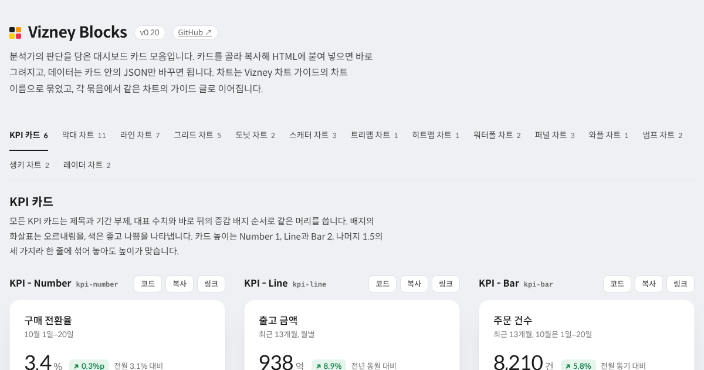

# Vizney Blocks

복사해 붙여 쓰는 HTML 대시보드 카드 모음입니다. KPI, 막대, 라인, 그리드, 도넛, 스캐터, 트리맵, 히트맵, 워터폴, 퍼널, 와플, 범프, 생키, 레이더 차트 48종을 [Vizney 차트 가이드](https://kr.vizney.com/chart-guide/)의 판단 규칙으로 만들었습니다.

Copy-paste HTML dashboard cards (48 cards in 14 chart types). No install, no framework: each card is one self-contained HTML snippet. Docs are in Korean.

**갤러리: https://blocks.vizney.com**



## 쓰는 법

1. 갤러리에서 카드를 골라 **복사**를 누르고, HTML의 `<body>` 안 원하는 자리에 붙여 넣습니다.
2. 카드 안 `<script type="application/json">`의 값만 바꿉니다. 증감, 비중, 달성률, 합계는 카드가 계산합니다.
3. 색과 글꼴은 내 페이지 `:root`의 `--vzb-*` 변수로 바꿉니다.

카드 하나는 스타일, 데이터, 스크립트를 한데 묶은 HTML 조각이라 설치할 라이브러리가 없습니다. 카드는 놓인 자리의 폭을 채우고, 높이는 1 · 1.5 · 2단위(1단위 168px) 중 하나라 한 줄에 섞어 놓아도 높이가 맞습니다. 여러 장은 감싸는 요소에 격자를 줍니다.

```html
<div style="display:grid; grid-template-columns:repeat(auto-fit, minmax(240px, 1fr)); gap:16px;">
  <!-- 카드 여러 장 -->
</div>
```

## AI에게 맡기기

갤러리의 **링크**는 카드 코드 주소(`https://blocks.vizney.com/cards/<카드 id>.txt`)를 복사합니다. 이 주소를 AI에게 주고 “이 카드로 우리 매출 데이터를 그려줘”처럼 요청하면 됩니다. 전체 카드 목록과 카드마다의 규칙은 [llms.txt](https://blocks.vizney.com/llms.txt)에 있습니다.

## 카드 목록

- **KPI 카드**: [KPI - Number](https://blocks.vizney.com/cards/kpi-number.html), [KPI - Line](https://blocks.vizney.com/cards/kpi-line.html), [KPI - Bar](https://blocks.vizney.com/cards/kpi-bar.html), [KPI - Gauge](https://blocks.vizney.com/cards/kpi-gauge.html), [KPI - Paired Bar](https://blocks.vizney.com/cards/kpi-paired-bar.html), [KPI - Stacked Bar](https://blocks.vizney.com/cards/kpi-stacked-bar.html)
- **막대 차트**: [Bar - Basic](https://blocks.vizney.com/cards/bar-basic.html), [Bar - Tabs](https://blocks.vizney.com/cards/bar-tabs.html), [Bar - Grouped](https://blocks.vizney.com/cards/bar-grouped.html), [Bar - Stacked](https://blocks.vizney.com/cards/bar-stacked.html), [Bar - Stacked 100%](https://blocks.vizney.com/cards/bar-stacked-100.html), [Bar - Target](https://blocks.vizney.com/cards/bar-target.html), [Bar - Diverging](https://blocks.vizney.com/cards/bar-diverging.html), [Bar - Ranking](https://blocks.vizney.com/cards/bar-ranking.html), [Bar - Compare](https://blocks.vizney.com/cards/bar-compare.html), [Bar - Progress](https://blocks.vizney.com/cards/bar-progress.html), [Bar - Butterfly](https://blocks.vizney.com/cards/bar-butterfly.html)
- **라인 차트**: [Line - Basic](https://blocks.vizney.com/cards/line-basic.html), [Line - Tabs](https://blocks.vizney.com/cards/line-tabs.html), [Line - Multiple](https://blocks.vizney.com/cards/line-multiple.html), [Line - Compare](https://blocks.vizney.com/cards/line-compare.html), [Line - Cumulative](https://blocks.vizney.com/cards/line-cumulative.html), [Line - Reference](https://blocks.vizney.com/cards/line-reference.html), [Line - Slope](https://blocks.vizney.com/cards/line-slope.html)
- **그리드 차트**: [Grid - Basic](https://blocks.vizney.com/cards/grid-basic.html), [Grid - Spark](https://blocks.vizney.com/cards/grid-spark.html), [Grid - Bars](https://blocks.vizney.com/cards/grid-bars.html), [Grid - Target](https://blocks.vizney.com/cards/grid-target.html), [Grid - Pivot](https://blocks.vizney.com/cards/grid-pivot.html)
- **도넛 차트**: [Donut - Basic](https://blocks.vizney.com/cards/donut-basic.html), [Donut - Tabs](https://blocks.vizney.com/cards/donut-tabs.html)
- **스캐터 차트**: [Scatter - Basic](https://blocks.vizney.com/cards/scatter-basic.html), [Scatter - Quadrant](https://blocks.vizney.com/cards/scatter-quadrant.html), [Scatter - Connected](https://blocks.vizney.com/cards/scatter-connected.html)
- **트리맵 차트**: [Treemap - Basic](https://blocks.vizney.com/cards/treemap-basic.html)
- **히트맵 차트**: [Heatmap - Basic](https://blocks.vizney.com/cards/heatmap-basic.html)
- **워터폴 차트**: [Waterfall - Basic](https://blocks.vizney.com/cards/waterfall-basic.html), [Waterfall - Subtotal](https://blocks.vizney.com/cards/waterfall-subtotal.html)
- **퍼널 차트**: [Funnel - Flow](https://blocks.vizney.com/cards/funnel-flow.html), [Funnel - Layers](https://blocks.vizney.com/cards/funnel-layers.html), [Funnel - Area](https://blocks.vizney.com/cards/funnel-area.html)
- **와플 차트**: [Waffle - Basic](https://blocks.vizney.com/cards/waffle-basic.html)
- **범프 차트**: [Bump - Basic](https://blocks.vizney.com/cards/bump-basic.html), [Bump - Focus](https://blocks.vizney.com/cards/bump-focus.html)
- **생키 차트**: [Sankey - Basic](https://blocks.vizney.com/cards/sankey-basic.html), [Sankey - Levels](https://blocks.vizney.com/cards/sankey-levels.html)
- **레이더 차트**: [Radar - Basic](https://blocks.vizney.com/cards/radar-basic.html), [Radar - Compare](https://blocks.vizney.com/cards/radar-compare.html)

## 소스에서 빌드하기

Node.js 18 이상과 Python 3의 fontTools가 필요합니다. 갤러리 페이지에 넣을 부분 글꼴을 만들 때 [Spoqa Han Sans Neo](https://github.com/spoqa/spoqa-han-sans) 글꼴 파일(`SpoqaHanSansNeo-Regular.ttf`, `-Medium.ttf`, `-Bold.ttf`)이 든 폴더를 씁니다.

```bash
pip install fonttools
SPOQA_DIR=/path/to/SpoqaHanSansNeo node build.mjs
```

- `src/`: 카드 공통 부품(`*.js`, `*.css`), 카드별 코드와 예시 데이터(`src/variants/`), 카테고리 설명과 규칙(`src/variants/meta.json`)
- `page/`: 갤러리 페이지
- `tools/`: 부분 글꼴 만들기, 글꼴 라이선스, 공유 이미지
- `docs/`: 빌드 결과. GitHub Pages가 이 폴더를 blocks.vizney.com로 내보냅니다.

## 라이선스

- 카드 코드와 갤러리: [MIT License](LICENSE)
- 글꼴: Spoqa Han Sans Neo, [SIL Open Font License 1.1](docs/OFL.txt). 갤러리 페이지에는 쓰인 글자만 담아 이름을 바꾼 부분 글꼴(VZ Sans)을 넣었고, 복사한 카드는 Spoqa 배포 링크로 글꼴을 불러옵니다.
