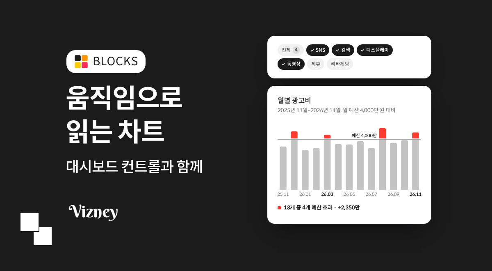

# Vizney Blocks

움직임으로 읽는 차트와 대시보드 컨트롤을 담은, 복사해 붙여 쓰는 HTML 카드 모음입니다. 한도를 넘긴 값, 뒤바뀐 순위, 달라진 비중처럼 움직여야 보이는 변화를 그리는 차트와, 그 차트를 거르고 내려받는 컨트롤을 [Vizney 차트 가이드](https://kr.vizney.com/chart-guide/)의 판단 규칙으로 만들었습니다.

Copy-paste HTML cards: charts you read through their motion, and the dashboard controls that go with them. No install, no framework: each card is one self-contained HTML snippet. The gallery, the card pages, llms.txt and the skill are in English (at /) and Korean (at /ko/); this README is in Korean.

**갤러리(English): https://blocks.vizney.com** · **한국어: https://blocks.vizney.com/ko/**



## 쓰는 법

1. 갤러리에서 카드의 **코드 복사**를 누르고, HTML의 `<body>` 안 원하는 자리에 붙여 넣습니다. 타일의 바탕 전환 단추로 밝은 바탕과 어두운 바탕을 바꿔 볼 수 있고, 복사한 코드에는 보이는 바탕이 담깁니다(어두운 바탕이면 `"theme": "dark"`).
2. 카드 안 `<script type="application/json">`의 값만 바꿉니다. 넘친 양, 비중, 순위, 증감, 합계는 카드가 계산합니다. 영어 화면에 쓸 때는 `"lang": "en"`을 더하면 카드가 직접 적는 문구가 영어가 됩니다.
3. 컨트롤을 차트와 이으려면 페이지에 짧은 스크립트를 씁니다. 컨트롤이 보내는 `vzb-change` 이벤트를 받아 차트 카드 안 JSON의 글자를 바꾸면, 그 카드가 다시 그려집니다(아래 '컨트롤과 차트 잇기').
4. AI에게 맡길 때는 카드의 **프롬프트 복사**를 눌러 채팅 AI에 붙여 넣고, 맨 위 대괄호 자리에 그릴 내용을 적습니다. 쓰는 법, 그 카드의 쓰임과 규칙, 바꿀 값, 카드 코드가 한 번에 복사되므로 주소를 열지 못하는 AI에서도 됩니다.

카드 하나는 스타일, 데이터, 스크립트를 한데 묶은 HTML 조각이라 설치할 라이브러리가 없습니다. 카드는 놓인 자리의 폭을 채웁니다. 차트 카드의 높이는 1 · 1.5 · 2단위(1단위 168px) 가운데 하나이고, 지금 있는 차트 카드는 모두 2단위(336px)입니다. 컨트롤은 카드 머리와 틀 없이 조작부만 그리므로 필터 줄이나 머리글에 그대로 놓습니다. 여러 장은 감싸는 요소에 격자를 주고, 차트 카드는 340px보다 좁히지 않습니다.

```html
<div style="display:grid; grid-template-columns:repeat(auto-fit, minmax(min(100%, 340px), 1fr)); gap:16px;">
  <!-- 차트 카드 여러 장 -->
</div>
```

색과 글꼴은 내 페이지 `:root`의 `--vzb-*` 변수로 바꿉니다. 변수 목록과 쓰임은 [tokens.css](https://blocks.vizney.com/ko/tokens.css)에 있습니다.

## 카드

차트 카드의 이름은 차트 종류 뒤에 그 카드의 움직임을 붙여 짓고(Bar Overflow: 막대가 한도를 넘침, Waffle Flip: 와플 칸이 뒤집힘, Bump Race: 범프 차트의 순위 다툼, Waterfall Walk: 워터폴의 단계를 한 걸음씩 걸어감, Funnel Wave: 퍼널의 단계를 물결처럼 흘러내림), 컨트롤은 찾는 말 그대로 짓습니다. 카드 id는 카드 이름을 소문자와 하이픈으로 적은 것입니다(Bump Race → `bump-race`). 카드 코드는 `https://blocks.vizney.com/ko/cards/<id>.txt`(영어는 `/cards/<id>.txt`)에, 그 카드만 그린 페이지는 같은 자리의 `.html`에 있습니다.

| 카드 | 종류 | 쓰는 때 |
|---|---|---|
| [Bar Overflow](https://blocks.vizney.com/ko/cards/bar-overflow.html) | 막대 차트 | 월 예산이나 월 처리량처럼 기간마다 같은 한도가 있는 값의 추이. 한도선을 넘긴 구간만 빨갛게 깜빡입니다 |
| [Waffle Flip](https://blocks.vizney.com/ko/cards/waffle-flip.html) | 와플 차트 | 시장 점유율이나 매출 구성비처럼 한 항목의 비중이 두 기간 사이에 얼마나 늘거나 줄었는지. 바뀐 만큼의 칸이 한 칸씩 뒤집힙니다 |
| [Bump Race](https://blocks.vizney.com/ko/cards/bump-race.html) | 범프 차트 | 상품 · 채널 · 지점의 순위가 기간마다 어떻게 오르내렸는지. 기간을 하나씩 넘기며 앞지르는 순간을 보여 줍니다 |
| [Waterfall Walk](https://blocks.vizney.com/ko/cards/waterfall-walk.html) | 워터폴 차트 | 시작 값에서 끝 값까지 무엇이 얼마나 늘리고 줄였는지. 점이 다음 항목으로 걸어가며 막대를 하나씩 이어 붙이고, 끝 막대의 말풍선이 끝 값과 증감을 알립니다 |
| [Funnel Wave](https://blocks.vizney.com/ko/cards/funnel-wave.html) | 퍼널 차트 | 리드에서 계약까지처럼 정해진 순서의 단계를 지나며 처음 100 가운데 얼마가 끝까지 오는지. 물이 흘러 들어와 단계마다 남은 만큼의 높이로 내려가고, 칸마다 첫 단계 대비 비율을 적습니다 |
| [Date Picker](https://blocks.vizney.com/ko/cards/date-picker.html) | 컨트롤 | 주문일이나 기준일처럼 날짜로 화면을 거를 때. 날짜 둘을 고르는 동안 기간과 일수가 따라오고, 고르면 띠가 시작일에서 끝일까지 그어집니다 |
| [Range Slider](https://blocks.vizney.com/ko/cards/range-slider.html) | 컨트롤 | 주문 금액이나 수량처럼 이어지는 값으로 화면을 거를 때. 끄는 동안 범위에 드는 분포가 레일 위에 뜹니다 |
| [Filter Chips](https://blocks.vizney.com/ko/cards/filter-chips.html) | 컨트롤 | 채널이나 지역처럼 몇 개 안 되는 이름으로 화면을 거를 때. 전체 칩이 지금 몇 개를 골랐는지 보여 줍니다 |
| [Download Button](https://blocks.vizney.com/ko/cards/download-button.html) | 컨트롤 | 화면에 있는 차트 카드의 지금 데이터를 CSV · JSON · PNG로 받을 때 |

카드마다의 규칙과 필드는 [llms.txt](https://blocks.vizney.com/ko/llms.txt)의 그 카드 줄에 있습니다.

v0.56에서 이전 방향의 카드와 차트 페이지를 모두 지웠습니다. 지금 있는 아홉 장이 전부이고, 카드는 하나씩 다시 더해 갑니다. 갤러리를 다시 채우는 동안에는 카드 이름이 바뀌면 id와 주소도 함께 바뀌고, 예전 주소는 남기지 않습니다(없는 주소는 첫 화면으로 안내하는 404 화면이 받습니다). 지운 내용은 [releases/v0.56.md](releases/v0.56.md)에 있습니다.

## 컨트롤과 차트 잇기

컨트롤과 차트는 서로를 모릅니다. 페이지의 짧은 스크립트가 컨트롤의 이벤트를 받아 차트 카드의 JSON을 바꿔 적습니다.

- 컨트롤은 값이 바뀌면 카드에서 `vzb-change` 이벤트(`detail: { name, value }`)를 보내고, 지금 값을 `data-vzb-value`에 적습니다. 처음 그릴 때는 이벤트를 보내지 않습니다.
- 차트 카드는 안의 JSON 글자가 바뀌면 그 카드만 다시 그립니다. 처음부터 재생하지 않고 마지막 장면을 바로 그리며, 보는 사람이 고른 기간과 항목은 그대로 둡니다.
- Download Button은 `target`에 적은 종류(`data-vzb`)의 카드 가운데 페이지에서 처음 만나는 카드의 지금 JSON을 받습니다. 받기 전에 `vzb-download` 이벤트를 보내고, 페이지가 `preventDefault()`를 부르면 파일을 만들지 않습니다.

```html
<div><!-- Filter Chips 카드 코드: "name": "channel" --></div>
<div id="spend"><!-- Bar Overflow 카드 코드 --></div>
<script>
const LABELS = ['25.11', '25.12', '26.01'];
const SPEND = { SNS: [8600000, 16200000, 9700000], 검색: [9500000, 10300000, 10100000] };
document.addEventListener('vzb-change', (e) => {
  if (e.detail.name !== 'channel') return;
  const picked = e.detail.value;
  const src = document.querySelector('#spend .vzb-card script[type="application/json"]');
  const d = JSON.parse(src.textContent);
  d.labels = picked.length ? LABELS : [];
  d.values = d.labels.map((_, t) => picked.reduce((sum, c) => sum + SPEND[c][t], 0));
  src.textContent = JSON.stringify(d);
});
</script>
```

## AI에게 맡기기

주소를 열 수 있는 AI에는 [llms.txt](https://blocks.vizney.com/ko/llms.txt)(영어는 [/llms.txt](https://blocks.vizney.com/llms.txt)) 주소를 줍니다. 첫 화면 제목 옆의 **AI용 링크 복사**가 이 주소를 복사합니다. 쓰는 법, 카드 여덟 장의 쓰임과 규칙, 카드 코드 주소, 컨트롤과 차트를 잇는 법이 들어 있습니다. 카드 한 장만 쓸 때는 그 카드의 `.txt` 주소를 주고 “이 카드로 우리 광고비 데이터를 그려 줘”처럼 요청하면 됩니다.

Claude Code, Cursor, Codex 같은 코딩 에이전트에는 스킬로 설치할 수 있습니다. 같은 카드와 규칙에 순서와 체크리스트, 예시가 더해져 있습니다.

```bash
npx skills add yehwanhwang/vizney-blocks
```

[OpenDesign](https://open-design.ai)에서는 같은 폴더를 플러그인으로 설치합니다. 앱의 **Plugins → Add → Skill → Import from link**에 `https://github.com/yehwanhwang/vizney-blocks/tree/main/skills/vizney-blocks`를 넣거나, 터미널에서 `od plugin install github:yehwanhwang/vizney-blocks/skills/vizney-blocks`를 실행합니다.

## 영어와 한국어

영어가 메인입니다. 영어는 `/`(첫 화면), `/cards/<id>.html` · `.txt`, [llms.txt](https://blocks.vizney.com/llms.txt), [tokens.css](https://blocks.vizney.com/tokens.css)에, 한국어는 `/ko/` 아래 같은 자리에 있습니다. 머리의 지구본으로 같은 페이지의 다른 언어로 갑니다. 카드 코드는 한 벌이고, 영어 카드는 영어 예시 데이터에 `"lang": "en"`을 넣은 것입니다. 차트 가이드 링크는 영어는 www.vizney.com, 한국어는 kr.vizney.com으로 갑니다. 예전 영어 주소(`/en/…`)는 v0.56에서 없앴습니다.

## 소스에서 빌드하기

Node.js 18 이상과 Python 3의 fontTools가 필요합니다. 사이트에 넣을 부분 글꼴을 만들 때 [Spoqa Han Sans Neo](https://github.com/spoqa/spoqa-han-sans) 저장소의 `Original/SpoqaHanSansNeo` 폴더(`SpoqaHanSansNeo-Regular.ttf`, `-Medium.ttf`, `-Bold.ttf`)를 씁니다. `Subset` 폴더의 글꼴은 커닝과 일부 기호(© – −)가 빠져 있고 Windows에서 줄 안의 글자 위치가 달라지므로 쓰지 않습니다.

```bash
pip install fonttools
SPOQA_DIR=/path/to/spoqa-han-sans/Original/SpoqaHanSansNeo node build.mjs
```

빌드는 맨 앞에서 `guard.mjs`를 돌려 카드가 규칙을 지키는지 검사합니다(카드 id는 카드 이름을 소문자와 하이픈으로 적은 것, 외부 리소스 없음, 색은 `tokens.css`의 변수만, 차트 카드의 높이 1 · 1.5 · 2단위와 컨트롤의 조작부 높이, 선택자와 변수는 `vzb` 접두, 툴팁은 키보드로도, 예시 JSON의 길이와 계산 필드, meta.json과 파일의 짝, 카드 안 문구는 모두 `tx()`를 거쳐 영어가 있을 것, 쓰지 않는 영어 문구가 없을 것, 영어 예시 데이터와 영어 규칙이 카드마다 있을 것). 어긋나면 사유를 적고 멈춥니다. 글꼴 없이 검사만 하려면 `node build.mjs --check`를 씁니다.

- `src/`: 카드 공통 부품(`core.js`와 `base.css`, `chart.js` · `slider.js` · `roll.js`와 같은 이름의 `.css`), 색과 글꼴 변수(`tokens.css`: 밝은 바탕 값과 어두운 바탕 `.vzb-dark` 값), 카드별 코드와 예시 데이터(`src/variants/<id>.js` · `.css` · `.json` · `.en.json`), 카드의 종류 · 쓰임 · 규칙(`src/variants/meta.json`), 스킬 예시(`src/skill/examples/`).
- 영어: 한국어가 원본이고 영어는 덧씌웁니다. 카드 안 문구(툴팁 · 낭독 문구 등)는 `src/core.js`의 `EN` 표와 `tx()`로 바뀌고, 사이트 문구는 `build.mjs`의 `WORDS`, 카드의 쓰임과 규칙은 `src/variants/meta.en.json`, 예시 데이터는 `<id>.en.json`(`"lang": "en"` 포함), 토큰 설명은 `src/tokens.en.css`(선언은 `tokens.css`와 같아야 합니다)에 있습니다. 카드를 더할 때는 이 넷을 함께 적어야 가드를 지납니다.
- `build.mjs`: 빌드 스크립트. `VERSION`, 공통 규칙(`RULES`), 컨트롤과 차트를 잇는 법(`CONNECT`), 스킬 원본, 첫 화면 갤러리 목록(`GALLERY`), 블록별 타일 폭(`SPAN`), 갤러리에서 되풀이할 카드(`LOOP`)가 들어 있습니다.
- `page/`: 사이트 화면(`site.css`, `site.js`), 머리글과 공유 이미지에 쓰는 로고(`vizney-logo.png`), 파비콘. 머리글은 Vizney 공통 헤더로, Vizney 블로그(kr.vizney.com · www.vizney.com) 헤더를 값 그대로 옮긴 것입니다(Vizney Styles도 같은 값을 씁니다). 블로그가 기준이므로 블로그가 바뀔 때만 값을 고칩니다. 카드 찾기는 돋보기나 ⌘K로 엽니다. UI 강조색은 블로그 포스트 이미지의 노랑(#ffcc00) 하나만 씁니다.
- `tools/`: 부분 글꼴 만들기(`font.py`), 글꼴 라이선스, 공유 이미지(영어 `og.png`, 한국어 `og-ko.png`). 공유 이미지는 Vizney 블로그 포스트 대표 이미지 서식(Figma 원본 1200 × 660)을 따르되 바탕은 검정으로, 오른쪽에는 실제 카드 두 장(Filter Chips와 Bar Overflow)을 둡니다. 빌드한 뒤 `docs/`를 띄워 두고 `node tools/og.mjs`(Playwright 필요)로 다시 만들고 한 번 더 빌드합니다.
- `docs/`: 빌드 결과. 첫 화면(`/`, `/ko/`), 카드 페이지와 코드(`/cards/`, `/ko/cards/`), `llms.txt`, `tokens.css`, 404 화면이 들어 있습니다. GitHub Pages가 이 폴더를 blocks.vizney.com으로 내보냅니다.
- `skills/vizney-blocks/`: 빌드 결과. 코딩 에이전트용 스킬(입구인 영어판 `SKILL.md`, 한국어로 일할 때 따르는 `SKILL.ko.md`, 예시 `examples/`)과 OpenDesign 플러그인 파일(`open-design.json`, `icon.svg`, `preview/index.html`)입니다. `docs/`처럼 직접 고치지 않습니다.
- `releases/`: 버전별 릴리스 노트. `VERSION`을 올린 커밋이 main에 들어오면 `.github/workflows/release.yml`이 GitHub 릴리스를 만듭니다.

카드와 사이트를 만드는 규칙(카드 선정과 이름, 크기, 색, 표현, 움직임, 사이트, 검증, 배포)은 [CLAUDE.md](CLAUDE.md)에 있습니다. 규칙이 바뀌면 그 변경을 담은 PR에서 CLAUDE.md도 함께 고칩니다.

## 후원

Vizney Blocks가 쓸모 있었다면 [GitHub Sponsors](https://github.com/sponsors/yehwanhwang)로 후원할 수 있습니다. 후원은 새 블록을 만드는 데 씁니다.

## 라이선스

- 카드 코드와 갤러리: [MIT License](LICENSE)
- 글꼴: Spoqa Han Sans Neo, [SIL Open Font License 1.1](docs/OFL.txt). 사이트에는 쓰인 글자만 담아 이름을 바꾼 부분 글꼴(VZ Sans)을 넣었고, 복사한 카드는 Spoqa 배포 링크로 글꼴을 불러옵니다.
